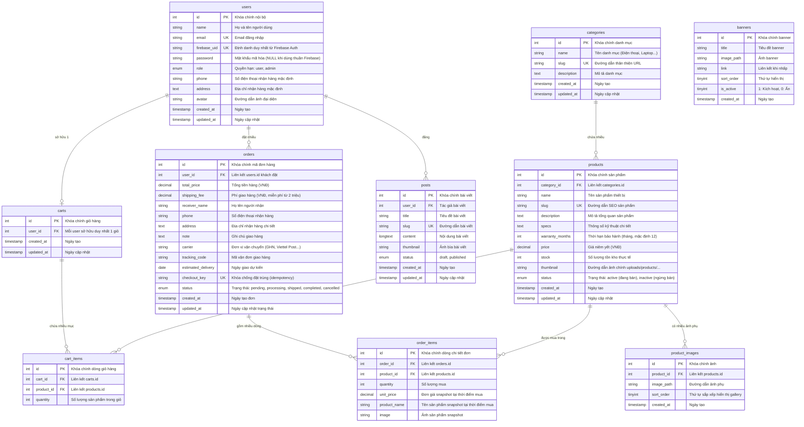

# Sơ đồ thực thể quan hệ (ERD) & Tài liệu Cơ sở Dữ liệu

Dự án: **BTA STORE (Nhóm 12) — Website Thương Mại Điện Tử Cửa Hàng Thiết Bị Công Nghệ**  
Cập nhật: **17/11/2026** (Phiên bản đồng bộ TV6: Firebase UID, Profile, Vận chuyển, Specs/Warranty)

---

## 1. Sơ đồ ERD (Entity Relationship Diagram)



---

## 2. Chi tiết các bảng và phân tích thiết kế

### 2.1. Bảng `users`
- **Mục đích:** Quản lý tài khoản, danh tính, thông tin liên hệ và phân quyền.
- **Tích hợp Firebase Auth:** Cột `firebase_uid` có ràng buộc `UNIQUE`, lưu UID do Firebase Authentication cấp. 
- **Cột `password`:** Cho phép `NULL` khi người dùng đăng ký qua Firebase. Với tài khoản truyền thống/kiểm thử local, mật khẩu được mã hóa bằng thuật toán `bcrypt` (`password_hash`).
- **Khóa chính nội bộ `users.id`:** Luôn được giữ nguyên làm khóa ngoại cho các bảng `carts`, `orders`, `posts`. Không dùng trực tiếp UID của dịch vụ thứ ba làm khóa ngoại hệ thống, đảm bảo tính độc lập và toàn vẹn dữ liệu.

### 2.2. Bảng `products` & `categories`
- **Mục đích:** Quản lý catalogue danh mục và thiết bị điện tử (Điện thoại, Laptop, Phụ kiện, Máy tính bảng).
- **Trường `status`:** Hỗ trợ `active` (đang bán) và `inactive` (ngừng bán). Khi sản phẩm bị ngừng bán (soft delete), khách không thể đặt thêm nhưng các đơn hàng cũ trong lịch sử vẫn hiển thị đầy đủ.
- **Trường `specs` & `warranty_months`:** Lưu thông số kỹ thuật chi tiết (màn hình, chip, RAM, dung lượng pin...) và số tháng bảo hành chính hãng (12, 18, 24, 36 tháng).

### 2.3. Bảng `carts` & `cart_items`
- **Mục đích:** Giỏ hàng cá nhân hóa theo từng người dùng đã đăng nhập (`user_id UNIQUE` trong `carts`).
- **Ràng buộc duy nhất:** `uq_cart_product (cart_id, product_id)` đảm bảo mỗi sản phẩm chỉ xuất hiện 1 dòng trong giỏ, tăng số lượng khi thêm lặp lại.

### 2.4. Bảng `orders` & `order_items`
- **Mục đích:** Quản lý đơn hàng COD, thông tin giao nhận và trạng thái xử lý đơn.
- **Thông tin vận chuyển:** Tích hợp trực tiếp các trường `carrier` (Đơn vị vận chuyển), `tracking_code` (Mã vận đơn), `estimated_delivery` (Ngày giao dự kiến) vào bảng `orders`. Theo quyết định thống nhất của nhóm: loại bỏ phần "thu tiền" phức tạp, không tạo thêm bảng phụ `deliveries` khi chưa cần nghiệp vụ mở rộng riêng.
- **Phí vận chuyển (`shipping_fee`):** Lưu độc lập để bảo toàn lịch sử giao dịch khi chính sách phí thay đổi. Quy tắc demo: Miễn phí giao hàng cho đơn từ 2.000.000 ₫, đơn dưới 2 triệu có phí 30.000 ₫.
- **Ràng buộc chống đặt trùng (`checkout_key`):** `UNIQUE KEY (user_id, checkout_key)` ngăn chặn sự cố gửi lặp request (double-submit) khi khách bấm nhiều lần.
- **Snapshot trong `order_items`:** Các cột `product_name`, `unit_price`, `image` lưu bản sao dữ liệu tại thời điểm đặt hàng. Khi admin cập nhật giá hoặc tên sản phẩm sau này, lịch sử đơn hàng của khách hàng không bị sai lệch.

---

## 3. Thứ tự chạy và chính sách di chuyển dữ liệu (Migration)

1. **Cài đặt mới:** Import trực tiếp `database/schema.sql` sau đó import `database/seed.sql`.
2. **Cập nhật database cũ đã có dữ liệu:** Chạy tệp `database/migration-tv6.sql` để bổ sung các cột mới mà không làm mất dữ liệu hiện có:
   ```sql
   SOURCE database/migration-tv6.sql;
   ```
